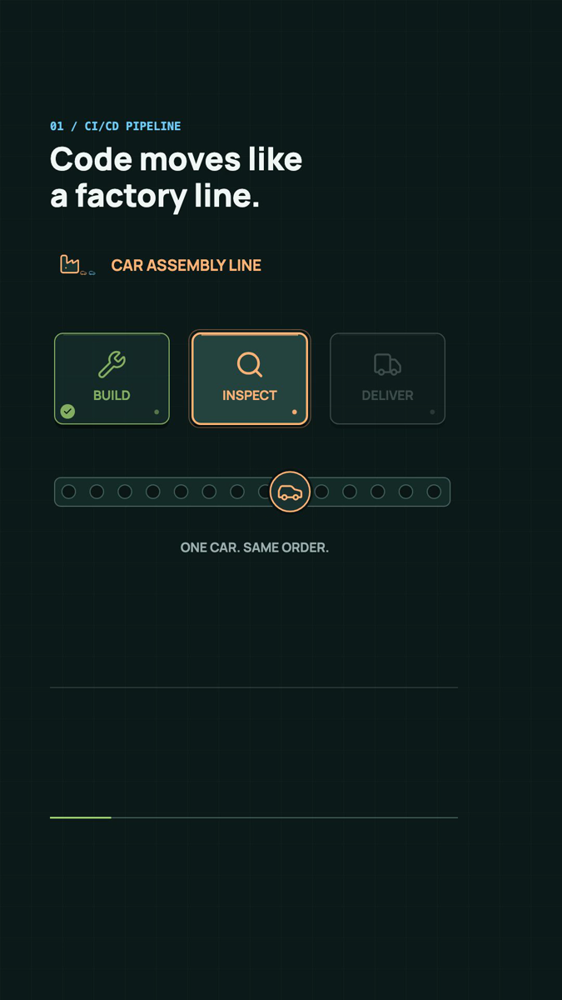
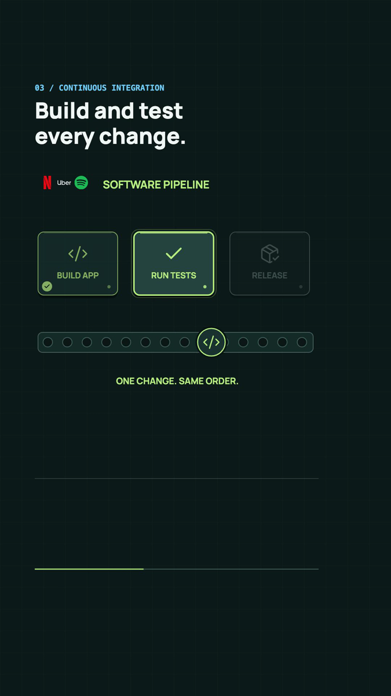
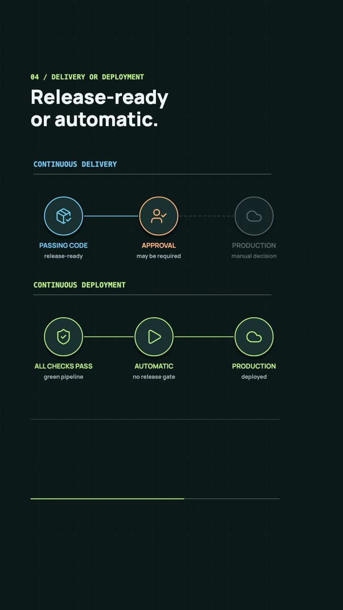
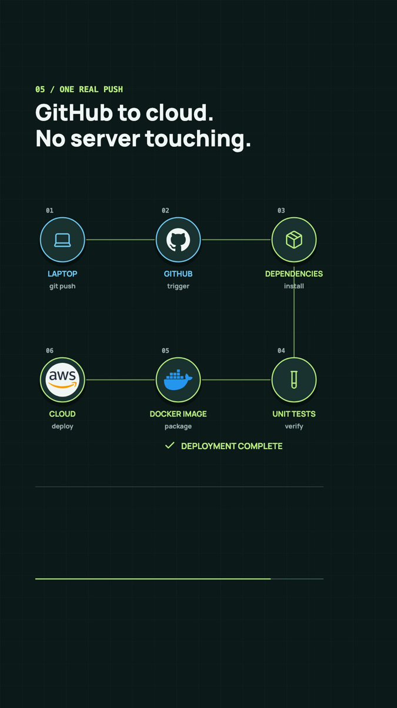
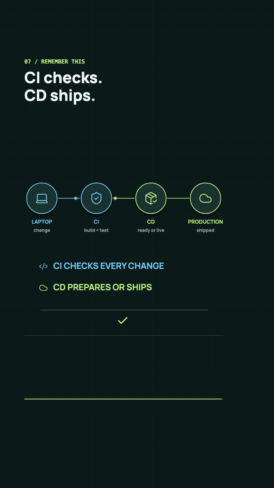

# CI/CD Pipelines: From Code to Production

**A CI/CD pipeline is actually super simple.**

Think of a car factory. A car does not jump from loose parts to the showroom. It moves through a fixed assembly line: build it, inspect it, then deliver it.

Code can move the same way.



The whole idea is this:

> Every code change follows the same automated path, so problems are caught early and releases become predictable.

## 0. What Is a Pipeline?

A pipeline is an ordered set of automated jobs.

```text
Code change -> Build -> Test -> Package -> Release or Deploy
```

A **stage** describes a phase such as test or deploy. A **job** performs concrete work inside a stage, such as running `npm test` or building a container image.

A **runner** is the machine that executes those jobs. It might be a temporary machine provided by GitHub, GitLab, or another CI platform. It can also be infrastructure your team manages.

The pipeline usually starts from an event:

- A commit is pushed.
- A pull request is opened.
- Code is merged into the main branch.
- A release tag is created.
- A schedule or manual action triggers it.

Automation does not remove engineering decisions. It makes those decisions repeatable.

## 1. CI Means Continuous Integration

Continuous Integration means developers integrate small changes into a shared repository frequently, then automated checks validate each change.

When code is pushed, CI might:

1. Install dependencies.
2. Compile or build the application.
3. Run linters and type checks.
4. Run unit and integration tests.
5. Scan dependencies or code for known security problems.
6. Produce a build artifact.



The key rule is causal:

```text
Push code -> Build succeeds -> Tests pass -> Change may continue
```

If the build fails, later jobs should not pretend the change is safe. If tests fail, deployment should stop.

### CI Is a Fast Feedback Loop

Without CI, a bug may wait until someone manually tests a large release. With CI, the developer can learn about a broken test minutes after pushing the responsible change.

CI does not mean developers stop testing locally. Local checks give immediate feedback. CI gives the team a shared, consistent result in a controlled environment.

### A Tiny GitHub Actions Example

```yaml
name: CI

on:
  pull_request:
  push:
    branches: [main]

permissions:
  contents: read

jobs:
  test:
    runs-on: ubuntu-latest
    steps:
      - uses: actions/checkout@<full-commit-sha>
      - uses: actions/setup-node@<full-commit-sha>
        with:
          node-version: 22
          cache: npm
      - run: npm ci
      - run: npm test
      - run: npm run build
```

The full commit SHA placeholders are intentional. GitHub recommends pinning third-party actions to immutable commit SHAs. Use verified SHAs from the real action repositories.

## 2. CD Has Two Common Meanings

CD can mean **Continuous Delivery** or **Continuous Deployment**. They share the same passing build, but production is reached differently.



### Continuous Delivery

Every passing change is kept **release-ready**. The pipeline builds, tests, and packages it, but production may still require a person to approve the release.

```text
Checks pass -> Release-ready artifact -> Approval -> Production
```

This fits teams that need a business decision, compliance review, coordinated launch, or controlled release window.

### Continuous Deployment

Every passing change can go to production automatically.

```text
Checks pass -> Automatic deployment -> Production
```

That does not mean "deploy recklessly." A mature deployment pipeline can still include protected branches, environment rules, security checks, staged rollout, health checks, and automatic rollback.

### The Difference in One Sentence

- **Delivery:** passing code is ready to release.
- **Deployment:** passing code is released automatically.

Vendor terminology sometimes varies, so define what `CD` means inside your team.

## 3. One Real Push, Step by Step

Imagine you push a checkout feature to GitHub.



### 1. Trigger

GitHub receives the push and starts the matching workflow. The workflow configuration decides which branches and events are allowed to run it.

### 2. Install

The runner checks out the code and installs locked dependencies. Reproducible installs matter because the pipeline should test the same dependency versions the team expects.

### 3. Test

Unit tests check small pieces of behavior. Integration tests check components working together. Add only meaningful checks, then keep them fast enough that developers do not avoid the feedback loop.

### 4. Package

The pipeline can build a Docker image. That image becomes an immutable release artifact containing the application and its runtime requirements.

Build it once, identify it with a unique version or digest, then promote that same artifact through environments. Rebuilding separately for production can create a different artifact from the one you tested.

### 5. Deploy

The pipeline authenticates to the cloud and updates the target environment. A production environment may require approval before its secrets become available or its job starts.

### 6. Verify

A successful deploy command is not proof that users are healthy. Check the running service, important endpoints, error rate, and rollout status. If those checks fail, stop or roll back.

## 4. What CI/CD Replaces, and What It Does Not

CI/CD can replace fragile manual steps:

- Copying release files by hand.
- Running undocumented commands from memory.
- SSHing into one server and hoping every server matches.
- Rebuilding the same release differently on each machine.
- Discovering basic test failures after deployment.

It does not replace:

- Good tests.
- Code review.
- Observability.
- A rollback strategy.
- Product judgment about when a feature should launch.
- Security controls around production.

Automation makes a good process repeatable. It also makes a bad process repeatable, so design the gates carefully.

## 5. Production Best Practices

### Keep the Pipeline Fast

Run independent jobs in parallel. Cache dependencies where it is safe. Put fast checks early so obvious failures stop expensive work.

Do not chase speed by skipping the checks that protect the release. Measure where time is actually spent.

### Build Once, Promote the Same Artifact

Give every artifact an immutable identity, such as a commit SHA or image digest. Record which source commit, workflow run, and configuration produced it.

That traceability answers a critical incident question: **What exactly is running?**

### Protect Production

Use a named production environment. Restrict which branches or tags may deploy. Add required reviewers when the workload needs approval. Keep environment secrets unavailable until protection rules pass.

### Use Least Privilege

Give the workflow token only the permissions each job needs. A test job usually does not need permission to modify the repository or deploy infrastructure.

For cloud access, prefer OpenID Connect and short-lived credentials over storing long-lived cloud keys in repository secrets.

### Treat Workflow Dependencies as Code

Third-party actions execute inside your pipeline and may access code, tokens, or secrets. Review what you use and pin actions to full commit SHAs when possible.

### Make Failure Safe

Set timeouts. Prevent two production deployments from racing when that would be unsafe. Keep the previous healthy artifact available. Define rollback before the first incident, not during it.

### Separate Build from Deployment

CI should be able to prove that an artifact passed its checks. Deployment should decide where that artifact may run. This separation lets the same tested release move from staging to production with different protection rules.

## 6. Common Mistakes

- **Only testing the happy path:** failures, permissions, migrations, and configuration changes also need coverage.
- **Putting secrets in logs or workflow files:** use a secret manager and review logs for accidental exposure.
- **Using one powerful token everywhere:** reduce permissions per job and environment.
- **Running deploy jobs on every branch:** restrict production to trusted branches or tags.
- **Calling a deploy successful too early:** verify the service after rollout.
- **Having no rollback path:** a fast pipeline can also ship a bad change faster.
- **Adding ten tools before one reliable workflow:** begin with build, test, package, and one controlled deployment.

## 7. A Practical Starting Plan

If your team deploys manually today, build the pipeline in this order:

1. Automate the build.
2. Add the fastest trustworthy tests.
3. Produce one versioned artifact.
4. Deploy that artifact to a non-production environment.
5. Add health checks and logs.
6. Add a protected production deployment.
7. Practice rollback.
8. Measure pipeline duration, failure rate, deployment frequency, and recovery time.

Do not start by copying a huge workflow from another company. Start with your real release process, remove fragile manual steps one by one, and keep every stage understandable.

## The Mental Model



- **CI checks every change.**
- **Continuous Delivery keeps it release-ready.**
- **Continuous Deployment ships passing changes automatically.**
- **The pipeline makes the path repeatable.**

An automated assembly line from your laptop to production.

That's literally it.

## Primary Sources

- [GitHub Docs: Continuous integration](https://docs.github.com/en/actions/get-started/continuous-integration)
- [GitHub Docs: Continuous deployment](https://docs.github.com/en/actions/get-started/continuous-deployment)
- [GitLab Docs: Get started with CI/CD](https://docs.gitlab.com/ci/)
- [GitHub Docs: Deployment environments](https://docs.github.com/en/actions/concepts/workflows-and-actions/deployment-environments)
- [GitHub Docs: Secure use reference](https://docs.github.com/en/actions/security-for-github-actions/security-guides/security-hardening-for-github-actions)
- [Docker Docs: Build overview](https://docs.docker.com/build/concepts/overview/)

Reviewed against primary sources: September 15, 2026.